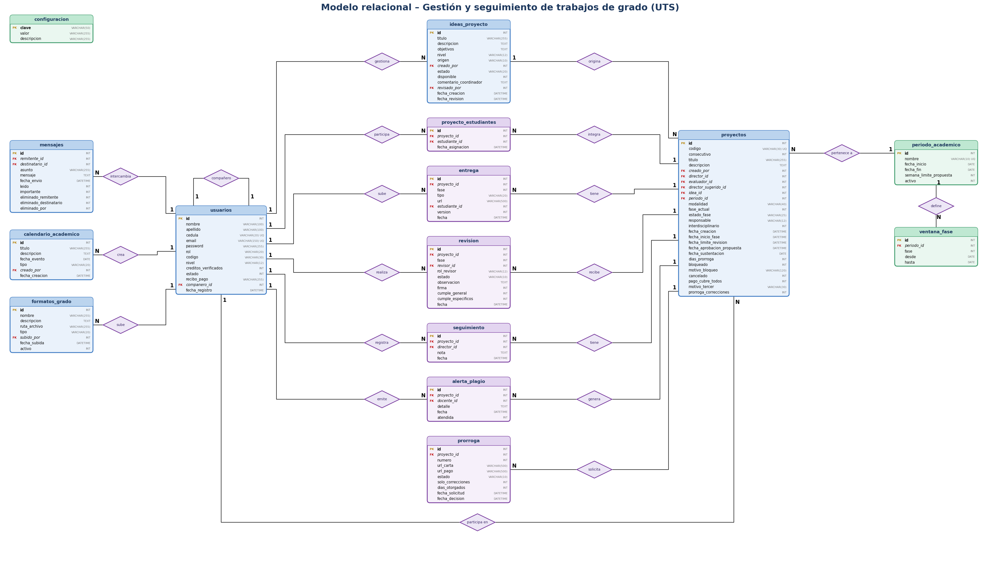

# Gestión y Seguimiento de Trabajos de Grado – UTS

Aplicación web para gestionar el proceso de trabajo de grado: banco de ideas, inscripción de proyectos, entregas por fases, revisiones del director, evaluador y comité, prórrogas, alertas de plagio, mensajería y calendario.

**Tecnologías:** JSP + JSTL · Apache Tomcat 9 · MySQL / MariaDB · JDBC (MySQL Connector/J 9.x)

## Documentación del proyecto

| Documento | Contenido |
|---|---|
| [`docs/modelo-entidad-relacion.png`](docs/modelo-entidad-relacion.png) | Modelo entidad–relación con llaves y cardinalidades |
| [`docs/modelo-relacional.png`](docs/modelo-relacional.png) | Modelo relacional con entidades, rombos de relación y cardinalidades |
| [`docs/Scrum_Sprints.md`](docs/Scrum_Sprints.md) | Documento Scrum completo (el mismo contenido de abajo) |
| [`LEEME.txt`](LEEME.txt) | Instrucciones de instalación y roles del sistema |

### Modelo relacional



## Metodología Scrum

El proyecto se desarrolló con Scrum en **tres sprints de siete días**. Cada sprint tiene su Sprint Planning (historias de usuario y estimación), su Sprint Review (demostración funcional) y su Sprint Retrospective (mejoras identificadas).

Para ver el código tal como quedó al cierre de cada sprint: `git checkout sprint-1`, `git checkout sprint-2` o `git checkout sprint-3` (y `git checkout main` para volver a la versión final).

### Marco de trabajo

| Elemento | Definición |
|---|---|
| Duración | 3 sprints de 7 días (Día 1 a Día 7) |
| Scrum Master | Integrante del equipo (facilita las ceremonias y retira impedimentos) |
| Product Owner | El Profesor (prioriza el backlog y acepta o rechaza las historias en el Review) |
| Development Team | Estudiantes del equipo |
| Tablero | Trello / Jira / GitHub Projects. Columnas: `Backlog` → `Sprint Backlog` → `En progreso` → `En revisión` → `Hecho` |
| Control de versiones | Git, con commits frecuentes y mensajes descriptivos |
| Tecnología | JSP + JSTL, Tomcat 9, MySQL/MariaDB, conector JDBC (MySQL Connector/J) |
| Estimación | Puntos de historia (escala Fibonacci: 1, 2, 3, 5, 8) |

#### Definición de Hecho (DoD)
Una historia se considera terminada cuando:
1. Cumple todos sus criterios de aceptación.
2. Funciona con los usuarios de prueba, sin errores en pantalla ni en el log de Tomcat.
3. Está subida a Git con commits descriptivos y la tarjeta está en `Hecho`.
4. El Product Owner la aceptó en el Sprint Review.

#### Convención de commits
```
feat: agrega registro de estudiantes con validación de correo institucional
fix: corrige redirección al panel según el rol
db: crea tablas entrega y revision con sus llaves foráneas
docs: agrega modelo entidad relación al repositorio
test: agrega pruebas de validación de contraseñas
```

#### Roles del sistema (usuarios de prueba)
Administrador, Comité, Docente (director/evaluador) y Estudiante, cada uno con su panel.

## Sprint 1 – Cimientos y acceso

**Objetivo del sprint:** dejar construida la base de datos, la conexión y el acceso seguro por roles, de modo que cada usuario pueda registrarse, iniciar sesión y entrar a su panel.

### 1.1 Sprint Planning (Día 1)

| ID | Historia de usuario | Criterios de aceptación | Pts |
|---|---|---|---|
| H1 | Como equipo, quiero el **Modelo Entidad–Relación** para tener claras las entidades y relaciones del sistema. | Diagrama con entidades, atributos, PK/FK y cardinalidades 1:N y N:M. Entregado en PNG. | 3 |
| H2 | Como equipo, quiero el **modelo relacional** para derivar las tablas de la base de datos. | Todas las tablas con tipos, llaves y restricciones. Coherente con el MER. | 3 |
| H3 | Como equipo, quiero un **script SQL con datos de prueba** para poder demostrar el sistema. | `proyecto_final_2.sql` crea la base y carga usuarios de cada rol, un periodo activo y proyectos de ejemplo. | 5 |
| H4 | Como desarrollador, quiero la **conexión JDBC** reutilizable para que todas las páginas accedan a la base. | `conexion.jspf` conecta con MySQL; las páginas la incluyen sin repetir código; UTF-8 configurado en `web.xml`. | 3 |
| H5 | Como visitante, quiero una **landing page** para conocer el sistema y llegar al login o al registro. | `index.jsp` con banner, descripción y enlaces a login y registro. | 3 |
| H6 | Como estudiante, quiero **registrarme** para acceder al sistema. | Valida correo institucional, cédula y código; rechaza correos o cédulas repetidos. | 5 |
| H7 | Como usuario, quiero **iniciar sesión con mi contraseña** para entrar de forma segura. | Contraseñas guardadas con hash SHA-256; solo entra un usuario activo; mensaje claro si falla. | 5 |
| H8 | Como administrador, quiero **control de acceso por rol** para que cada usuario solo vea lo que le corresponde. | `validar_sesion.jspf` redirige al panel del rol y bloquea el acceso a páginas de otros roles. | 5 |
| H9 | Como usuario, quiero **cambiar mi contraseña y cerrar sesión**. | `cambiar_password.jsp` y `logout.jsp` funcionan en los cuatro roles. | 2 |
| | **Total comprometido** | | **34** |

**Capacidad estimada:** 34 puntos en 7 días.

**Tablero:** todas las historias entran a `Sprint Backlog` el Día 1.

### 1.2 Sprint Review (Día 7) – Demostración funcional

Guion de la demo ante el Product Owner:
1. Mostrar el MER y el modelo relacional y explicar las relaciones principales.
2. Importar el script SQL y mostrar las tablas con sus datos de prueba.
3. Abrir la landing page y navegar a registro y login.
4. Registrar un estudiante nuevo (probar también un correo no institucional y una cédula repetida).
5. Iniciar sesión con un usuario de cada rol y mostrar que cada uno llega a su panel.
6. Intentar abrir por URL una página de otro rol y mostrar que el sistema la bloquea.
7. Cambiar contraseña y cerrar sesión.

**Resultado de la revisión (completar con el Profesor):**

| Historia | ¿Aceptada? | Observaciones del Product Owner |
|---|---|---|
| H1 – H9 | ☐ Sí ☐ No | |

### 1.3 Sprint Retrospective (Día 7)

| ¿Qué salió bien? | ¿Qué no salió bien? | Mejoras para el Sprint 2 |
|---|---|---|
| *(completar en equipo)* | *(completar en equipo)* | *(acciones concretas, con responsable)* |

Preguntas guía: ¿se cumplió la capacidad estimada? ¿los commits fueron frecuentes y claros? ¿hubo historias que se subestimaron?

## Sprint 2 – Núcleo del negocio

**Objetivo del sprint:** construir el corazón del sistema: ideas y proyectos de grado con sus entregas e integrantes, búsqueda con filtros, perfil de usuario y paneles diferenciados por rol.

### 2.1 Sprint Planning (Día 1)

| ID | Historia de usuario | Criterios de aceptación | Pts |
|---|---|---|---|
| H10 | Como docente o comité, quiero un **CRUD del banco de ideas** para ofrecer temas de trabajo de grado. | Crear, editar, eliminar, aprobar y rechazar ideas; una idea tomada deja de estar disponible. | 5 |
| H11 | Como estudiante, quiero **inscribir mi proyecto** a partir de una idea para iniciar mi trabajo de grado. | Genera código de proyecto, asocia el periodo activo y valida que el estudiante no tenga otro proyecto activo. | 8 |
| H12 | Como estudiante, quiero **subir entregas por enlace** en cada fase (relación **1:N** proyecto–entrega). | Registra tipo de documento, URL válida y versión; conserva el historial de entregas. | 5 |
| H13 | Como estudiante, quiero **elegir compañeros** para el proyecto (relación **N:M** estudiantes–proyectos). | Hasta tres integrantes por proyecto mediante la tabla `proyecto_estudiantes`. | 5 |
| H14 | Como comité o administrador, quiero un **buscador con filtros** para encontrar proyectos. | Filtra por periodo, fase, estado, responsable y director; muestra los resultados en tabla. | 5 |
| H15 | Como usuario, quiero **editar mi perfil** (datos personales) para mantener mi información al día. | `guardar_perfil.jsp` actualiza nombre, apellido y datos de contacto del usuario. | 3 |
| H16 | Como cada rol, quiero un **panel diferenciado** para ver solo mis funciones. | Panel de administrador, comité, docente y estudiante con menús propios. | 5 |
| H17 | Como comité, quiero **asignar director y evaluador** a un proyecto. | Deben ser dos docentes distintos; se guarda en `proyectos` y se notifica en el panel del docente. | 3 |
| | **Total comprometido** | | **39** |

> **Nota de diseño:** en este sistema el perfil del usuario (relación 1:1) se guarda dentro de la tabla `usuarios`, por lo que H15 no necesita una tabla aparte.

### 2.2 Sprint Review (Día 7) – Demostración funcional

1. Como docente: crear una idea y, como comité, aprobarla y rechazar otra.
2. Como estudiante: inscribir un proyecto desde una idea, elegir compañero y confirmar el código generado.
3. Intentar inscribir un segundo proyecto y mostrar la validación.
4. Subir una entrega por enlace, volver a subirla y mostrar el historial de versiones.
5. Como comité: asignar director y evaluador (probar que no se acepte el mismo docente en ambos cargos).
6. Usar el buscador con distintas combinaciones de filtros.
7. Editar el perfil y recorrer los cuatro paneles por rol.

**Resultado de la revisión (completar con el Profesor):**

| Historia | ¿Aceptada? | Observaciones del Product Owner |
|---|---|---|
| H10 – H17 | ☐ Sí ☐ No | |

### 2.3 Sprint Retrospective (Día 7)

| ¿Qué salió bien? | ¿Qué no salió bien? | Mejoras para el Sprint 3 |
|---|---|---|
| *(completar en equipo)* | *(completar en equipo)* | *(acciones concretas, con responsable)* |

Preguntas guía: ¿las historias de 8 puntos se pudieron dividir mejor? ¿hubo bloqueos entre integrantes? ¿el tablero reflejó el avance real?

## Sprint 3 – Operación y cierre

**Objetivo del sprint:** completar el flujo de revisión por fases con prórrogas, comunicación y calendario, agregar reportes y pruebas, y dejar el sistema desplegado y documentado.

### 3.1 Sprint Planning (Día 1)

| ID | Historia de usuario | Criterios de aceptación | Pts |
|---|---|---|---|
| H18 | Como director, evaluador o comité, quiero **revisar cada fase** para aprobar, aplazar o rechazar. | Guarda decisión, observación obligatoria si no se aprueba, firma y fecha en `revision`. | 8 |
| H19 | Como estudiante, quiero **solicitar prórrogas** y como comité aprobarlas. | Carta y pago por enlace; máximo dos prórrogas de 180 días; el comité decide. | 5 |
| H20 | Como docente, quiero **registrar alertas de plagio** para que el comité las atienda. | Alerta con detalle y estado atendida/pendiente. | 3 |
| H21 | Como usuario, quiero **mensajería interna** para comunicarme con otros roles. | Enviar, responder, marcar leído/no leído y eliminar. | 5 |
| H22 | Como administrador o comité, quiero el **calendario académico y la base documental**. | Eventos por fecha y enlaces a formatos y reglamento visibles para todos. | 3 |
| H23 | Como comité, quiero **reportes con consultas de agregación** para tomar decisiones. | Mínimo tres reportes con `COUNT`, `GROUP BY` y `AVG` (por ejemplo, proyectos por fase, carga por director y prórrogas por periodo). | 5 |
| H24 | Como equipo, quiero **pruebas unitarias** para asegurar la calidad. | Pruebas (por ejemplo JUnit) de validaciones clave: correo institucional, contraseña, un solo proyecto activo y director distinto de evaluador. | 5 |
| H25 | Como equipo, quiero **desplegar el sistema** en Tomcat. | Aplicación accesible desde el servidor con la base de datos importada. | 3 |
| H26 | Como equipo, quiero la **documentación final**. | Manual de instalación, `LEEME.txt`, MER, modelo relacional y este documento Scrum. | 3 |
| | **Total comprometido** | | **40** |

### 3.2 Sprint Review (Día 7) – Demostración funcional

1. Recorrido completo de un proyecto: entrega del estudiante, revisión del director, del evaluador y del comité.
2. Rechazar o aplazar una fase y mostrar la observación obligatoria.
3. Solicitar una prórroga y aprobarla como comité (y verificar el límite de dos).
4. Registrar una alerta de plagio y atenderla.
5. Enviar y responder un mensaje entre dos roles.
6. Mostrar el calendario y la base documental.
7. Mostrar los reportes de agregación y ejecutar las pruebas unitarias.
8. Demostrar el sistema desplegado en Tomcat.

**Resultado de la revisión (completar con el Profesor):**

| Historia | ¿Aceptada? | Observaciones del Product Owner |
|---|---|---|
| H18 – H26 | ☐ Sí ☐ No | |

### 3.3 Sprint Retrospective (Día 7)

| ¿Qué salió bien? | ¿Qué no salió bien? | Lecciones para futuros proyectos |
|---|---|---|
| *(completar en equipo)* | *(completar en equipo)* | *(acciones concretas)* |

## Resumen de los tres sprints

| Sprint | Enfoque | Historias | Puntos |
|---|---|---|---|
| 1 | Cimientos y acceso | H1 – H9 | 34 |
| 2 | Núcleo del negocio | H10 – H17 | 39 |
| 3 | Operación y cierre | H18 – H26 | 40 |
| | **Total** | **26 historias** | **113** |

**Fuera de alcance:** retiros y cambios (requerimientos 39 y 40).

## Instalación

1. Instala XAMPP (MySQL/MariaDB) y Apache Tomcat 9.
2. Importa `base_datos/proyecto_final_2.sql` en phpMyAdmin.
   **Advertencia:** el script empieza con `DROP DATABASE` y borra la base `proyecto_final_2`.
3. Copia esta carpeta como aplicación web en Tomcat. La conexión está en `WEB-INF/fragments/conexion.jspf` (usuario `root` sin clave, base `proyecto_final_2`).
4. Abre `http://localhost:8080/<nombre-de-la-aplicacion>/`.

## Usuarios de prueba (solo para desarrollo local)

| Rol | Correo | Clave |
|---|---|---|
| Administrador | admin@uts.edu.co | Admin123 |
| Comité | coordinador@uts.edu.co | Coord123 |
| Docente | diego.alvarez@uts.edu.co | Doc12345 |
| Estudiante | laura.gomez@uts.edu.co | Est12345 |

Estos datos son de ejemplo. No uses estas credenciales ni la conexión `root` sin clave en un servidor real.

## Estructura

```
admin/ coordinador/ docente/ evaluador/ estudiante/   paneles y procesos por rol
WEB-INF/fragments/                                     conexión, sesión, cabeceras y bloques reutilizables
base_datos/                                            script SQL y respaldo
css/ js/ img/ formatos/                                recursos estáticos
docs/                                                  modelos y documentación Scrum
```
